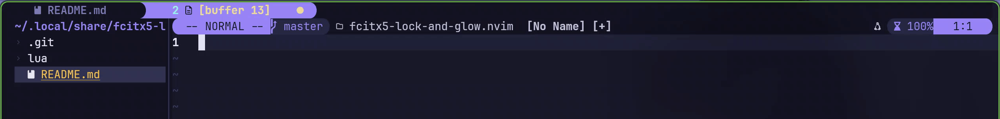
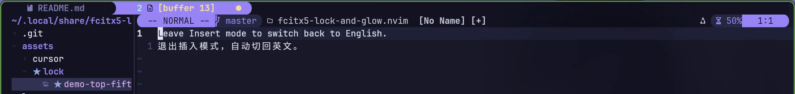

# Fcitx5 Lock & Glow

Mode-aware Fcitx5 locking and input-method cursor colors for Neovim.

## Demo

Both demos were recorded in Neovide with `lock.restore = false`.

### Cursor color

Switching from English to Rime changes the cursor color in Neovide (also works
in terminal Neovim; verified in Kitty).



### Mode-aware locking

Type Chinese in Insert mode, press Esc, then use `hjkl` in Normal mode without
manually switching input methods. Returning to Insert mode keeps English active
with `restore = false`.

Command-line mode (`:`, `/`, `?`) does not force English; you can choose your
input method freely there. Customize this mode whitelist with
`lock.unlocked_modes` (see [Configuration](#configuration)).



The buffer-tab styling shown in the demo is provided by
[Barbar Bubbles](https://github.com/zxzxn3/barbar-bubbles.nvim), a separate plugin.

## Requirements

- Linux desktop session with a working session D-Bus connection.
- Running Fcitx5 with its D-Bus addon (`org.fcitx.Fcitx5`).
- Neovim 0.10+ for the plugin; Neovim 0.12+ for the `vim.pack` example below.
- `fcitx5-remote` (Fcitx5) and `gdbus` (GLib/GIO tools) on PATH.
- Optional `dbus-monitor` for event-driven updates; otherwise polling continues.

An active Fcitx5 input context is required to query or change the current input
method. Normally the focused desktop application supplies it. In a headless or
otherwise context-free session, Fcitx5 may return an empty name; the plugin treats
that as unknown rather than assuming English.

Tray signals require an active Fcitx5 notificationitem addon and a registered
StatusNotifierWatcher; installing the addon alone does not guarantee signals.
Without those signals, periodic queries still work but detection can take up to
the polling interval.

## Installation

Choose one plugin manager.

### vim.pack (Neovim 0.12+)

Add to your `init.lua` before the setup call:

```lua
vim.pack.add {
  'https://github.com/zxzxn3/fcitx5-lock-and-glow.nvim',
}
require('fcitx5-lock-and-glow').setup {}
```

Use `vim.pack.update({ 'fcitx5-lock-and-glow.nvim' })` to update the installed copy.

### lazy.nvim

Add this entry to your existing lazy.nvim plugin specifications:

```lua
{
  'zxzxn3/fcitx5-lock-and-glow.nvim',
  main = 'fcitx5-lock-and-glow',
  lazy = false,
  opts = {},
}
```

`main` selects the setup module, and `opts` is passed to `setup()` automatically:
do not call it a second time.

Disable any existing Neovim input-method lock before enabling this plugin.
Installing this plugin does not disable other locks automatically.

References: [Neovim packages](https://neovim.io/doc/user/pack/),
[lazy.nvim plugin specifications](https://lazy.folke.io/spec).

## Configuration

For vim.pack, replace the empty setup options with the following. For lazy.nvim,
use the table contents as `opts` instead of calling `setup()` yourself:

```lua
require('fcitx5-lock-and-glow').setup {
  lock = {
    enabled = true,
    ascii_im = 'keyboard-us',
    restore = false,
    unlocked_modes = { 'i', 'R', 't', 'c', 's', 'S', '\019' },
  },
  cursor = {
    enabled = true,
    color = '#ffbf69',
    input_methods = { 'rime' },
  },
  source = {
    monitor = true,       -- false uses polling only
    poll_interval = 5000, -- positive milliseconds; also retries dead monitors
  },
}
```

These are the defaults. Requiring the module alone does not start monitoring or
switch input methods. Setup is once per Neovim process; restart to change options.

By default, text-entry modes (Insert, Replace, terminal, command line, and Select)
allow the user's choice; other modes enforce `ascii_im` while Neovim is focused.
`lock.unlocked_modes` replaces this list. Each entry matches the first character
of Neovim's mode code (see `:help mode()`), so `'i'` includes Insert completion
and `'R'` includes Virtual Replace. `'\019'` means blockwise Select (Ctrl-S).
An empty list locks every mode while focused. For example, to also allow Visual
mode, use:

```lua
lock = {
  unlocked_modes = { 'i', 'R', 't', 'c', 's', 'S', '\019', 'v', 'V', '\022' },
}
```

Here `'v'`, `'V'`, and `'\022'` cover characterwise, linewise, and blockwise
Visual mode. This option controls both locking and, when enabled, restoration
at the boundary between locked and unlocked modes.

`lock.ascii_im` is the Fcitx5 input-method name to enforce; it need not be
`keyboard-us`. Select the desired input method and run `fcitx5-remote -n` to find
its name. Likewise, `cursor.input_methods` lists the names that trigger the
highlight color; it is not restricted to Rime or Chinese.

With `restore=false`, entering a text-entry mode does not restore a previous
input method. With `restore=true`, the lock remembers and restores that choice
on text-entry/focus changes and attempts restoration on exit.

Cursor color follows input method names, not an input method's internal ASCII
mode. Disabling the cursor does not disable locking, and vice versa.

## Desktop integration

Input-method changes are detected through D-Bus signals, with polling as a
fallback. Without tray signals, detection may take up to `source.poll_interval`.
Each Neovim instance runs its own monitor, which is stopped on exit.

Fcitx5 input-method sharing settings affect other applications. This plugin does
not create a separate input context for the editor. On desktops with D-Bus
activation, querying a stopped Fcitx5 service may start it again.

Cursor coloring depends on the GUI or terminal honoring Neovim's cursor-color
settings; it has been demonstrated in Neovide and Kitty.

<details>
<summary>Validation scope</summary>

The locking and cursor behavior was tested with isolated Fcitx5 5.1.23 and
Neovim 0.12.6 instances. The demos show Rime input in Neovide; cursor coloring
was also checked in terminal Neovim running in Kitty.

Additional checks for the revised tray monitor, real GUI focus transitions,
custom mode lists, and the minimum supported Neovim version are in progress.

</details>
